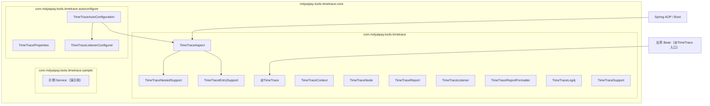
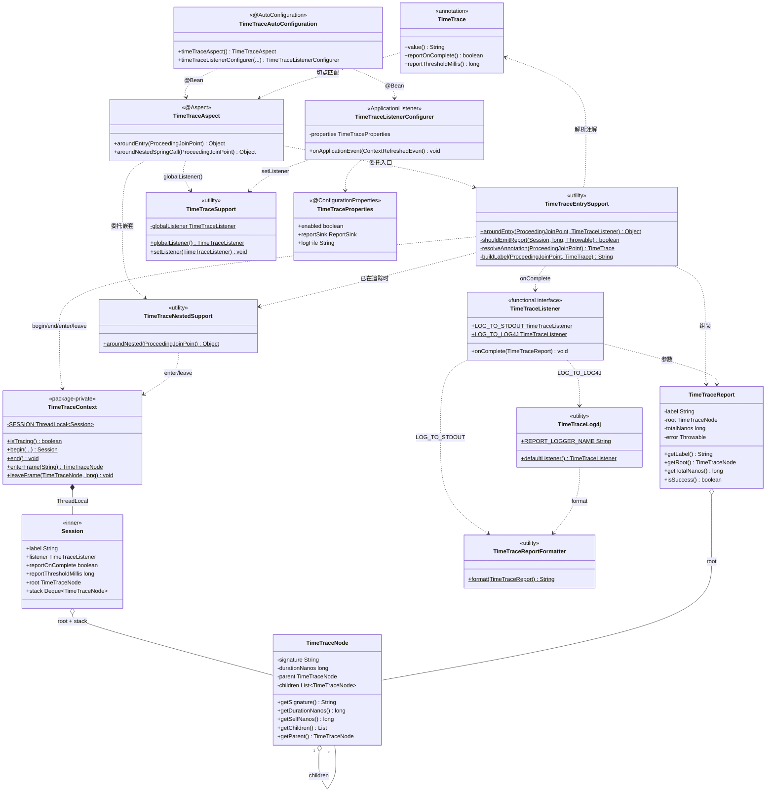
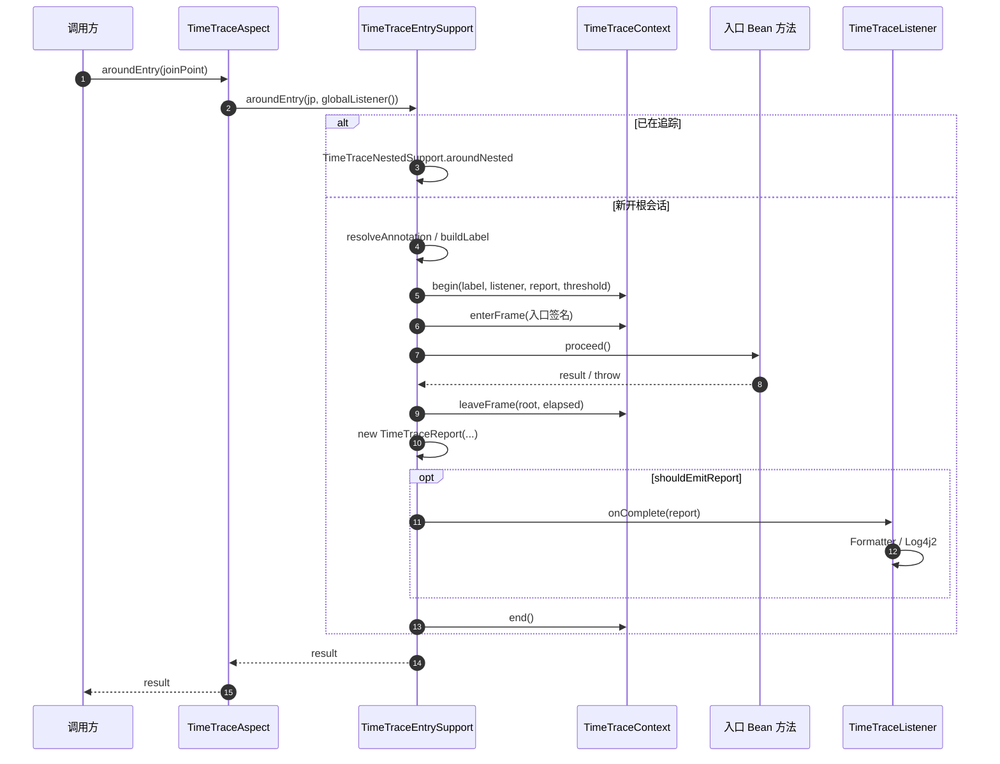
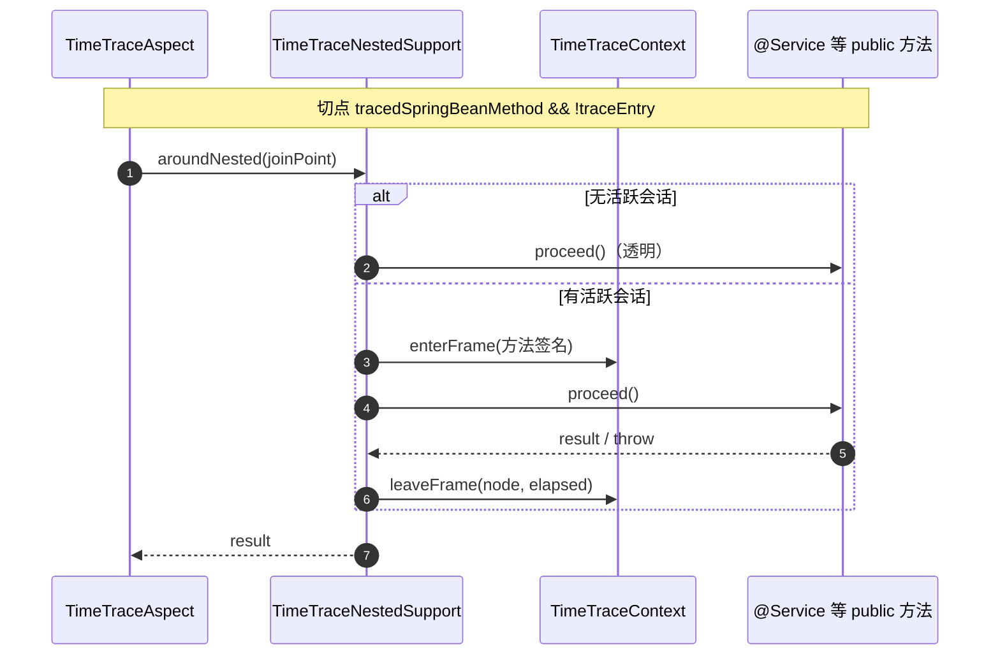
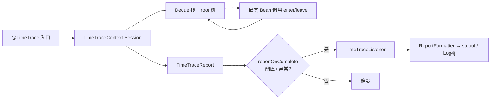
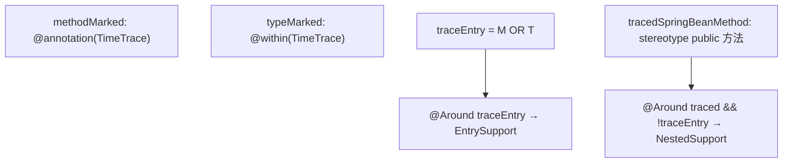

# @TimeTrace 设计（mdyaipay-tools-timetrace）

## 目标

在 Spring 管理的 Bean 上标注 `@TimeTrace`，在一次入口调用结束后输出：

1. **入口方法** wall-clock 总耗时；
2. 可选的慢调用门槛（`reportThresholdMillis`）与自定义报告回调。

基于 **Spring AOP**（`@Aspect` + `spring-boot-starter-aop`），不对业务模块做 AspectJ 编译期织入。

## 模块

- Artifact：`mdyaipay-tools-timetrace-core`（聚合父工程 `mdyaipay-tools-timetrace`）
- 包：`com.mdyaipay.tools.timetrace`
- 依赖：`spring-aop`（AspectJ 注解风格，运行时由 Spring 代理织入）
- 不依赖业务模块；业务模块按需引入本 artifact。

## 组件

| 类型 | 职责 |
|------|------|
| `@TimeTrace` | 标记入口（`TYPE` / `METHOD`），可选 `value`、`reportOnComplete`、`reportThresholdMillis` |
| `TimeTraceAspect` | `@TimeTrace` 入口报告 + 会话内 Spring Bean public 方法计帧 |
| `TimeTraceNestedSupport` | 活跃会话内 `enterFrame` / `leaveFrame`，不重复开报告 |
| `TimeTraceEntrySupport` | 入口 advice 逻辑（会话、计时、回调） |
| `TimeTraceContext` / `TimeTraceNode` | 线程内状态与报告根节点 |
| `TimeTraceReport` | 汇总结果 |
| `TimeTraceListener` / `TimeTraceReportFormatter` | 报告输出 |
| `TimeTraceSupport` | 全局 `TimeTraceListener` 配置 |

## UML

以下用 [Mermaid](https://mermaid.js.org/) 描述 `mdyaipay-tools-timetrace-core` 结构与运行时协作；在 GitHub、多数 IDE 预览中可直接渲染。

### 包结构



### 核心类图

| 关系 | 含义 |
|------|------|
| `TimeTraceAspect` → Support | 切面只做路由，逻辑在 Entry / Nested |
| `TimeTraceContext` | 线程内会话；不跨线程传播 |
| `TimeTraceNode` 自关联 | 调用树父子结构 |
| `TimeTraceListener` | 报告 sink；Boot 经 `TimeTraceListenerConfigurer` 写入 `TimeTraceSupport` |



### 入口追踪时序（`@TimeTrace` 根会话）



### 嵌套计帧时序（会话内 Spring Bean）



### 运行时数据流



### AOP 切点关系



## 接入（Spring Boot）

依赖：

```xml
<dependency>
    <groupId>com.mdyaipay</groupId>
    <artifactId>mdyaipay-tools-timetrace-core</artifactId>
</dependency>
<dependency>
    <groupId>org.springframework.boot</groupId>
    <artifactId>spring-boot-starter-aop</artifactId>
</dependency>
```

`TimeTraceAutoConfiguration` 会通过 `META-INF/spring/org.springframework.boot.autoconfigure.AutoConfiguration.imports` 自动注册 `TimeTraceAspect`（在 `AopAutoConfiguration` 之后）。

可选配置：

```yaml
mdyaipay:
  timetrace:
    enabled: true        # false 时不注册切面 Bean
    report-sink: log4j   # log4j | stdout；Boot 启动时注册全局 TimeTraceListener
    log-file: logs/timetrace.log   # 供 log4j2 中 TimeTrace 专用 RollingFile 引用
```

Log4j2 落盘：Listener 写入 Logger `com.mdyaipay.tools.timetrace.report`。业务模块引入 `spring-boot-starter-log4j2`（排除默认 Logback），并配置 `log4j2-spring.xml` 将该 Logger 绑定文件 Appender。参考 `mdyaipay-payment`。

修改 `mdyaipay-tools-timetrace-core` 后需 **`mvn -pl mdyaipay-tools/mdyaipay-tools-timetrace/mdyaipay-tools-timetrace-core install`**（或从仓库根目录 `install`），再重启业务进程；否则 `spring-boot:run` 仍可能加载本地仓库中的旧 JAR，报告只会走 stdout，`logs/timetrace.log` 为空。

参考：`mdyaipay-payment`（仅依赖上述两个 artifact，无手写 Configuration）。

## 限制

- 入口仅 **`@TimeTrace`** 标记的 Bean 方法；会话内会统计其它 **`@Service` / `@Repository` / `@Component` / `@Controller`** Bean 的 **public** 方法为子节点（无需再标注）。
- 同类内部 `this.xxx()` 自调用、**private** 方法不会被 Spring AOP 拦截，不出现在树中。
- 异步线程内需在新入口再次标注 `@TimeTrace` 才单独成报告。
- 生产环境对热点路径谨慎开启，或配合 `reportThresholdMillis`。

## 测试

模块内 `TimeTraceAspectTest` 使用 `@ImportAutoConfiguration` 加载 `AopAutoConfiguration` 与 `TimeTraceAutoConfiguration`。

```bash
mvn -pl mdyaipay-tools/mdyaipay-tools-timetrace/mdyaipay-tools-timetrace-core test
```

## 使用示例

```java
@TimeTrace(value = "收单创建", reportThresholdMillis = 200)
public PaymentOrder createAndPay(...) { ... }
```

```java
TimeTraceSupport.setListener(report -> logger.info(TimeTraceReportFormatter.format(report)));
```
